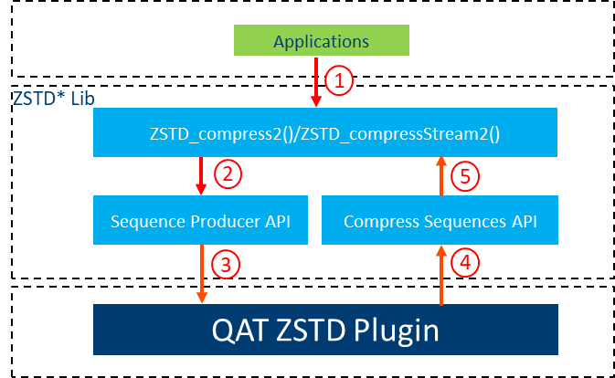

# Intel® QuickAssist Technology ZSTD Plugin (QAT ZSTD Plugin)


## Table of Contents

- [Introduction](#introduction)
- [Licensing](#licensing)
- [Hardware Requirements](#hardware-requirements)
- [Software Requirements](#software-requirements)
- [Limitations](#limitations)
- [Installation](#installation)
- [Integration Guide](#integration-guide)
- [Legal](#legal)


## Introduction

The Intel® QuickAssist Technology ZSTD Plugin (QAT ZSTD Plugin) is a high-performance plugin for Zstandard (ZSTD), designed to accelerate compression using Intel® QAT hardware.ZSTD\* is a fast lossless compression algorithm, targeting real-time compression scenarios at zlib-level and better compression ratios. From version [v1.5.4](https://github.com/facebook/zstd/releases/tag/v1.5.4), ZSTD provides a block-level sequence producer API, enabling users to register custom sequence producers. The QAT sequence producer leverages Intel® QAT to offload the generation of block-level sequences (literals and matches), resulting in significant performance improvements for compression levels L1–L12. The produced list of sequences is then post-processed by ZSTD to generate valid compressed blocks, ensuring compatibility and optimal compression results.

Intel® QAT provides cryptographic and compression acceleration, enhancing data center efficiency and throughput. The QAT ZSTD Plugin integrates seamlessly with ZSTD, allowing applications to benefit from hardware-accelerated compression with minimal code changes.

<p align="center">
    
</p>


## Hardware Requirements

- Intel® QuickAssist Technology Gen 4 (Intel® 4xxx series), available on 4th Gen Intel® Xeon® Scalable processors and newer platforms


## Software Requirements

- [Zstandard v1.5.7](https://github.com/facebook/zstd)
- [Intel® QAT Driver for Linux\* Hardware v2.0 - QAT20.L.1.2.30-00090](https://www.intel.com/content/www/us/en/download/765501.html) (out-of-tree) or [Intel® QATlib 25.08](https://github.com/intel/qatlib) (intree)


## Limitations

1. Supports compression levels L1–L12.
2. Only ZSTD compression APIs that respect advanced parameters are supported (e.g., `ZSTD_compress2`, `ZSTD_compressStream2`).
3. The `ZSTD_c_enableLongDistanceMatching` parameter is not supported; enabling it will cause compression to fail with QAT sequence producer.
4. Dictionaries are not supported; Compression will succeed if the dictionary is referenced, but the dictionary will have no effect.
5. Stream history is not supported; each block is treated as an independent chunk without history from previous blocks.
6. Multi-threading within a single compression is not supported. Compression will fail if `ZSTD_c_nbWorkers > 0` and an external sequence producer is registered. Each thread must use its own context (`CCtx`).

For further details, see [zstd.h](https://github.com/facebook/zstd/blob/dev/lib/zstd.h).


## Installation

### 1. Install Intel® QAT Driver (out-of-tree) or QATlib (in-tree)

Choose either the [Intel® QAT Driver for Linux\* Hardware v2.0](https://www.intel.com/content/www/us/en/download/765501.html) (out-of-tree) or [QATlib](https://github.com/intel/qatlib) (in-tree) based on your requirements.

#### out-of-tree:
1. Download and install the driver using [Getting Started Guide](https://www.intel.com/content/www/us/en/content-details/632506/intel-quickassist-technology-intel-qat-software-for-linux-getting-started-guide-hardware-version-2-0.html)).
2. For virtual environments, refer to [Intel® VT with QAT](https://www.intel.com/content/www/us/en/content/details/709210/using-intel-virtualization-technology-intel-vt-with-intel-quickassist-technology-application-note.html).
3. Update the QAT configuration files `/etc/<QAT_devid>.conf` as described in the [Programmer's Guide](https://intel.github.io/quickassist/PG/configuration_files_generalsection.html).
4. Ensure the configuration file contains a `[SHIM]` section (required by QAT ZSTD Plugin) with `dc` services enabled. You may:
    - Add a `[SHIM]` section manually, or
    - Set the environment variable `QAT_SECTION_NAME` to modify the default section name.
    ```ini
    [GENERAL]
    ServicesEnabled = dc

    # ... Other details

    [SHIM]
    NumberCyInstances = 0
    NumberDcInstances = 64
    NumProcesses = 1
    LimitDevAccess = 0

    # Data Compression - User instance #0
    Dc1Name = "Dc0"
    Dc1IsPolled = 1
    Dc1CoreAffinity = 0

    # Data Compression - User instance #1
    Dc2Name = "Dc1"
    Dc2IsPolled = 1
    Dc2CoreAffinity = 1

    # ... repeat for each DC instance up to Dc63 ...

    # Data Compression - User instance #63
    Dc63Name = "Dc63"
    Dc63IsPolled = 1
    Dc63CoreAffinity = 63
    ```

5. Restart the QAT service:
    ```bash
    service qat_service restart
    ```

#### QATlib (in-tree) Installation
QATlib is available as a RPM package for RHEL, Fedora, Ubuntu, Debian, and SUSE distributions, or can be installed from source ([qatlib/INSTALL](https://github.com/intel/qatlib/blob/main/INSTALL)). Refer [QATlib](https://intel.github.io/quickassist/qatlib/index.html) User Guide for additional information.

#### USDM or SVM Support

By default, the QAT sequence producer library uses Shared Virtual Memory (SVM), allowing direct submission of application buffers to QAT hardware for optimal performance. If SVM is not enabled, memory passed to QAT hardware must be DMA-enabled. In this case, Intel's User Space DMA-able Memory (USDM) component provides the necessary support, and the QAT ZSTD Plugin automatically switches to USDM mode. To enable SVM, update the BIOS and driver configuration as described in the [Intel® VT with QAT](https://www.intel.com/content/www/us/en/content/details/709210/using-intel-virtualization-technology-intel-vt-with-intel-quickassist-technology-application-note.html) and the [Programmer's Guide](https://intel.github.io/quickassist/PG/index.html).

### 2. Build QAT Sequence Producer Library

out-of-tree:
Set the `ICP_ROOT` environment variable to the root directory of the QAT driver source tree.

QATlib (in-tree):
Set the QATlib installation path environment variables before building (default shown below):
```bash
export LIBRARY_PATH=/usr/local/lib
export LD_LIBRARY_PATH=/usr/local/lib
```

Build the library:
```bash
make
```
If ZSTD 1.5.4+ is not installed system-wide, specify the path to the ZSTD source:
```bash
make ZSTDLIB=[PATH_TO_ZSTD_LIB_SOURCE]
```
Install the library:
```bash
make install
```

### 3. Build and Run Test Program

```bash
make test
./test/test [TEST_FILENAME]
```

### 4. Build and Run Benchmark Tool

The `benchmark` tool evaluates QAT sequence producer performance. Supported options:
```bash
-t#   Set maximum threads [1–128] (default: 1)
-l#   Set iteration loops [1–1,000,000] (default: 1)
-c#   Set chunk size (default: 32K)
-E#   Auto/enable/disable searchForExternalRepcodes (0: auto; 1: enable; 2: disable; default: auto)
-L#   Set compression level [1–12] (default: 1)
-m#   Benchmark mode (0: software; 1: QAT; default: 1)
```
For optimal performance, increase the number of threads (`-t`). Ensure the number of test threads does not exceed the number of DC instances configured in `/etc/4xxx_devx.conf`

Example benchmark usage with [Silesia compression corpus](https://sun.aei.polsl.pl/~sdeor/index.php?page=silesia):
```bash
./benchmark -m1 -l100 -c64K -t64 -E2 Silesia
```


## Integration Guide

### Integrating QAT Sequence Producer with `zstd`

To accelerate compression in the `zstd` command-line tool, modify `FIO_compressZstdFrame` in `zstd/programs/fileio.c` to include `qatseqprod.h` and link with `-lqatseqprod`.

**Initialization (before compression):**
```c
/* Initialize and start the QAT device before beginning compression */
QZSTD_startQatDevice();
/* Create a state object for the QAT sequence producer */
void *sequenceProducerState = QZSTD_createSeqProdState();
/* Register the QAT sequence producer with the ZSTD compression context */
ZSTD_registerSequenceProducer(
    ress.cctx,
    sequenceProducerState,
    qatSequenceProducer
);
/* Enable fallback to the default software sequence producer if QAT is unavailable */
ZSTD_CCtx_setParameter(ress.cctx, ZSTD_c_enableSeqProducerFallback, 1);
```

**Cleanup (after compression):**
```c
QZSTD_freeSeqProdState(sequenceProducerState);
QZSTD_stopQatDevice(); // Call before process exit or when QAT is no longer needed
```

Recompile `zstd` with `-lqatseqprod`. Only single-threaded mode is supported; use `--single-thread`:
```bash
./zstd --single-thread [TEST_FILENAME]
```
Note: Some `zstd` parameters are not compatible with sequence producer. Refer to the [zstd manual](https://github.com/facebook/zstd/blob/dev/doc/zstd_manual.html) for details.

### Integrating QAT Sequence Producer in Applications

**Initialization:**
```c
/* Create a ZSTD compression context */
ZSTD_CCtx* const zc = ZSTD_createCCtx();
/* Start and initialize the QAT device before compression */
QZSTD_startQatDevice();
/* Create sequence producer state for QAT sequence producer */
void *sequenceProducerState = QZSTD_createSeqProdState();
/* Register the QAT sequence producer with the ZSTD context */
ZSTD_registerSequenceProducer(zc, sequenceProducerState, qatSequenceProducer);
/* Enable fallback to software sequence producer if QAT is unavailable */
ZSTD_CCtx_setParameter(zc, ZSTD_c_enableSeqProducerFallback, 1);
```

**Compression:**
```c
/* Perform compression using standard ZSTD APIs */
/* You may use ZSTD_compress2, ZSTD_compressStream2, or ZSTD_compressStream as needed */
ZSTD_compress2(zc, dstBuffer, dstBufferSize, srcBuffer, srcbufferSize);
```

**Cleanup:**
```c
/* Free the sequence producer state to release resources */
QZSTD_freeSeqProdState(sequenceProducerState);
/* Stop and clean up the QAT device before process exit or when QAT is no longer needed */
QZSTD_stopQatDevice();
```

Link your application to both `libzstd` and `libqatseqprod` as demonstrated in the test program. See the example in `test/test.c`.


## Licensing

This project is licensed under the BSD License. Please refer to the `LICENSE` file in the root directory for details. Additional licensing information is available in the file headers of individual source files.

## Legal

Intel, Intel Atom, and Xeon are trademarks of Intel Corporation in the U.S. and/or other countries.

\*Other names and brands may be claimed as the property of others.

Copyright © 2016-2026, Intel Corporation. All rights reserved.
